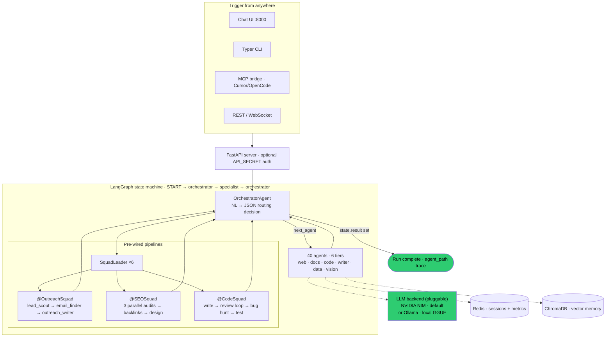

# 30 Agents — self-hosted multi-agent pipelines

[](https://github.com/sgm-audio/30-agents/actions/workflows/ci.yml)
[](LICENSE)

A LangGraph + FastAPI system that routes a task through specialist agents and returns the result with a trace of which agents ran. It includes pre-wired pipelines for outreach (lead scraping, email enrichment, email drafting) and SEO audits. The LLM backend is NVIDIA NIM by default, or a local Ollama server (`LLM_BACKEND=ollama`).

The repo name is historical: the registry now holds **40 agents** (`agents/registry.py`, checked by `tests/test_registry_count.py`).

---

## Architecture



Every specialist returns a partial `AgentState`; setting `result` ends the run. The list of agents that ran is recorded in `agent_path`.

---

## What is implemented

Checked against the code on 2026-10-31:

- 40 agents in 6 tiers, routed by an orchestrator (`agents/registry.py`, `core/graph.py`)
- Per-agent retry with exponential backoff via tenacity (`agents/base.py:87-89`)
- 6 squads defined in `squads/config/*.json` (analytics, code, content, outreach, SEO, vision)
- Outreach pipeline: scrape, enrich, generate, send via Resend. The CLI defaults to dry run (`main.py:475`); pass `--send` to actually send.
- SEO pipeline: on-page, technical and content checks, then backlinks
- Sessions in Redis, vector memory in ChromaDB
- Tool-call allowlist and blocked-argument patterns (`core/security_gate.py`); Discord webhook URLs must be https on a Discord domain (`core/discord_webhook.py`)
- MCP stdio bridge exposing 14 tools (`tools/mcp_bridge.py`)

**Authentication is open by default.** If `API_SECRET` is not set, every endpoint accepts requests without a key (`api/server.py:135-160`, and `tests/test_auth_open_by_default.py` asserts this). When `API_SECRET` is set, requests without the right key get **401**. Set `API_SECRET` before exposing the server beyond localhost. CORS allows `*` unless `CORS_ORIGINS` is set (`core/config.py:65`).

**Not implemented yet:**

- Human-in-the-loop approval tools (designed, not wired)
- Per-agent backend override (e.g. NIM for some agents, Ollama for others)

**Test status (2026-10-31, Python 3.12, `pytest -q`):** 124 passed, 1 failed (`tests/test_validation.py::TestWebhookUrlStorage::test_update_accepts_discord`).

---

## Quick start

**Windows** — double-click `Start-Agents.bat` (first run creates the venv + installs deps), then open http://127.0.0.1:8000/. `Stop-Agents.bat` shuts it down.

**macOS / Linux** — `./start` (venv + Redis + Ollama + API), then open http://127.0.0.1:8000/.

```bash
python main.py health                        # LLM backend + Redis + ChromaDB
python main.py chat "your task"              # one-shot orchestrated run
python main.py outreach --city Vancouver     # dry-run outreach pipeline
pytest                                       # test suite
```

**Docs:** [PRD](docs/PRD.md) · [ADR-001 — pluggable inference](docs/ADR-001.md) · [Operator guide](docs/OPERATIONS.md) · [Windows smoke checklist](docs/WINDOWS_SMOKE.md)

**LLM backend:** default is **NVIDIA NIM** (cloud, needs an API key) (`LLM_BACKEND=nim`, needs `NVIDIA_API_KEY`/`NIM_API_KEY`). For fully local, key-free inference set `LLM_BACKEND=ollama` and run Ollama — health then reports the active backend. Without either the API still runs; health reports `degraded`.

**Optional outreach keys** (`.env`): `SERPER_API_KEY`, `TAVILY_API_KEY`, `FIRECRAWL_API_KEY`, `HUNTER_API_KEY`, `RESEND_API_KEY`, `OUTREACH_EMAIL_FROM`, `OUTREACH_DOMAIN`.

**License:** see [LICENSE](LICENSE). Third-party notices: [THIRD_PARTY_NOTICES.md](THIRD_PARTY_NOTICES.md).
